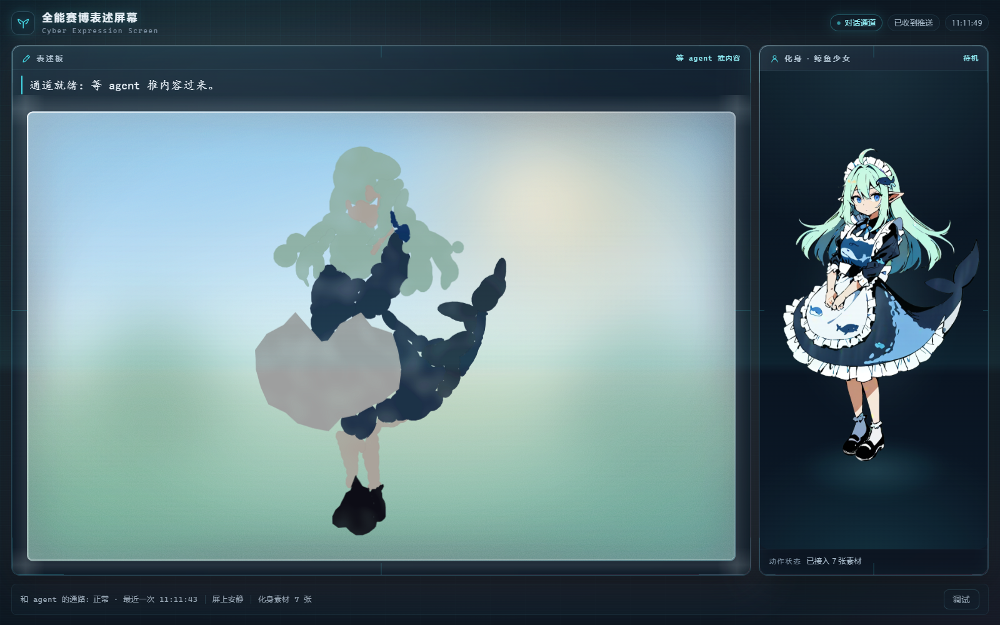

# Cyber Expression Screen

**一块会自己画画的玻璃黑板，加上一个能呼吸、能动的化身。**

给 AI agent 做「脸」用的前端层：agent 不必只能打字——它可以在这块板上把想法**画**出来，一笔一笔地长出来，旁边还有一张会表情、会游动的化身在陪着。



> React 18 + Canvas 2D + TypeScript。零运行时依赖（除 React 本身），零后端，`npm install && npm run dev` 就能看。

---

## 它解决什么问题

聊天的界面只有文字。但 agent 真正想表达的东西——关系、心情、形状、"你看这个像不像那个"——用文字描述很笨。

这块屏幕给了它第二种语言：

- **黑板可以演**：一份 script 交给它，笔画按节奏一笔笔长出来，粉笔有颗粒、有湿边、落笔处玻璃上有反光
- **化身可以动**：7 张立绘（待机/笑/卖萌/害羞/思考/跑/挥手）+ 程序化的呼吸与眨眼，配一套动作状态机
- **人可以插进来**：切到「我要画」，鼠标就是粉笔，你画的笔迹和 agent 画的分层叠放、颜色不同
- **有一条 live 通道**：agent 往 `public/live/board.json` 写 payload，屏端轮询它，推过来就演，不用重启

---

## 跑起来

```sh
npm install
npm run dev        # http://127.0.0.1:5180
```

| 命令 | 作用 |
|---|---|
| `npm run dev` | 开发服务器（HMR） |
| `npm run build` | 产出 `dist/` |
| `npm run typecheck` | `tsc --noEmit`，无输出即通过 |
| `npm run preview` | 预览构建产物 |

---

## 目录

```
src/
├── features/
│   ├── blackboard/          ← 主角。黑板：三层语义 + 笔刷 + 玻璃 + 演出调度
│   ├── avatar/              化身容器（立绘解析，manifest 优先）
│   ├── motion/              动作状态机（idle / breathe / blink / swim）
│   ├── rig/                 骨骼解算与播放（把动作变成元素变换）
│   ├── human/               人的笔迹层（手绘、心情文字）
│   ├── live/                live 通道（轮询 board.json）
│   └── skin/                玻璃科幻皮肤（面板、HUD、扫描线、色板）
├── artwork/                 程序化生成的画（鲸鱼、鱼群、心情脚本）
├── pages/                   整屏装配（表述板 + 化身 + 状态行 + 调试抽屉）
└── shared/                  共用小工具
```

### 黑板的三层语义

这块板最关键的设计：**不是一张画布，是三张叠起来的。**

| 层 | 名字 | 谁看得见 | 干什么 |
|---|---|---|---|
| Layer 0 | `hidden` | 默认**不给看** | 靶子（trace 产出）。调试时才显现，用来核对"画得像不像" |
| Layer 1 | `visible` | 看得见 | agent 亲手画的每一笔 |
| Layer 2 | `result` | 看得见 | 结果层（填充、上色、最终形态） |

这个分层让「过程」和「结果」能分开演：可以先画骨架让人看它怎么长，最后再一次性把结果铺上去。擦除动画也不会把靶子闪出来。

---

## 想直接拿黑板组件用

它不依赖整屏装配，独立可用：

```tsx
import { Blackboard, useBlackboardScript } from './features/blackboard';

const script = useBlackboardScript(moment);      // 从消息里取黑板脚本
const [busy, setBusy] = useState(false);

<Blackboard script={script} onBusyChange={setBusy} />
```

`script` 就是一份「笔画指令清单」（见 `features/blackboard/types.ts`）：

```ts
{
  title: '一尾鱼',
  ops: [
    { kind: 'path', points: [...], style: { width: 3, alpha: 0.9 } },
    { kind: 'text', text: '游过来了', at: [120, 80] },
  ],
  paceMs: 60,     // 每笔间隔
}
```

不传 `script` 会用 `demoScript.ts` 里的内置演示——所以单独渲染一个 `<Blackboard />` 就能看到东西在动。

---

## 能被 agent 直接驱动

屏端轮询 `public/live/board.json`：

```json
{ "seq": 7, "script": { "title": "...", "ops": [...] } }
```

`seq` 变了就换一份 script 演。agent 端只要写这个文件，屏上立刻有反应，不用刷新、不用握手。文件不存在时中间件回 `{"seq":0}`，控制台不会多一条 404。

---

## 设计上的几条纪律

- **零重依赖。** 除 React 外不加库。几何、笔刷、玻璃都是自己写的，为的是这块板能被嵌进任何地方，而不是绑死在一个组件库上。
- **零 console error。** 立绘清单在构建期注入（`virtual:avatar-manifest` 虚拟模块），前端只引用真实存在的文件，不靠盲目试文件名。
- **表现与几何分离。** 后端/模型负责「画什么形状」，前端只负责「怎么把它演出来」。所以换掉上游不影响这块板。
- **过程可看。** 笔画是逐笔长出来的，不是一次性贴上去的——这是它区别于普通画布的地方。

---

## 已知限制

- **单屏应用。** 目前只有一屏布局，没做响应式；窄屏下会挤。
- **立绘是固定 7 张。** 加动作要改 `features/avatar/avatarAssets.ts` 的 `MANIFEST_KEY` 并在 `public/avatars/manifest.json` 里补条目。
- **live 通道是轮询。** 本地够用（`board.json` 在本机），不适合跨机器。
- **没有测试。** 类型检查和人工验收，没写单测。

---

## License

MIT
